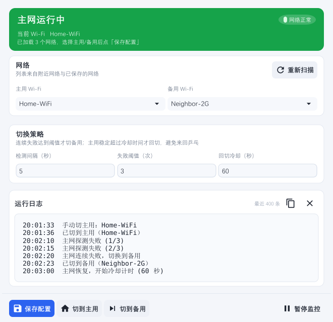
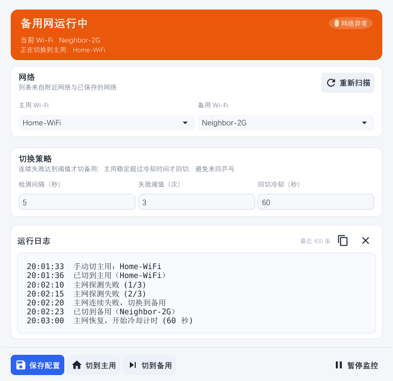
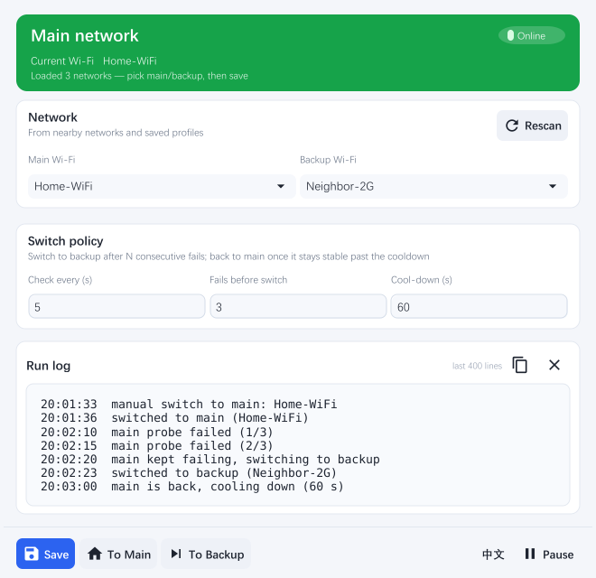

# WiFi Auto Switch

**主网断了自动切备用，主网回来自动切回 —— 一个托盘常驻的 Wi‑Fi 双保险工具。**

> A tray-resident Wi‑Fi failover switcher: jumps to your backup SSID when the main network dies,
> and switches back once it has been stable again. Single binary, no daemon, no cloud.

Windows / macOS · Go + [Fyne](https://fyne.io) · MIT License



## 它解决什么问题

路由器时不时抽风、5G 频段信号时好时坏、家里两条宽带想自动兜底 —— 手动切网既麻烦又容易忘。
这个工具常驻托盘，按你的规则自动切：**连续探测失败达到阈值 → 切备用；主网恢复并稳定超过冷却时间 → 切回**，全程有冷却时间防「来回乒乓」。



英文界面（同一次运行内切换，无需重启）：



## 功能

- **托盘常驻**（Windows / macOS），关闭窗口 = 最小化到托盘，托盘图标随状态变色（主网=绿，备用=橙），菜单里可直接切主用/备用
- **自动扫描**：启动即列出可用 / 已保存的 Wi‑Fi，下拉直接选，不用手打 SSID
- **状态机**：主优先 → 连续失败切备用 → 主网稳定超过冷却后回切；每轮用真实 SSID 校准状态，不会因为误判陷入死循环
- **暂停监控**：临时停掉自动切网（仍继续探测、显示状态），不必退出程序
- **连通性探测**：HTTP **或** ping 任一通即算通，比单一路径更接近「真的能上网」
- **切换结果以实际关联为准**：连接后轮询当前 SSID 最多 20 秒，只有真的关联上才算成功，不会出现「假成功」
- **平台分离**：Windows 走原生 `WlanConnect`（netsh 兜底）；macOS 走 `airport` + `networksetup`，网卡自动探测（不硬编码 `en0`）
- **不打扰**：子进程全部隐藏窗口，不会周期性闪黑窗或弹 PowerShell；窗口尺寸适配 1080p + 125% 缩放
- **中英文界面**：右下角一键切换（中文界面显示 `EN`，英文界面显示 `中文`），首次启动按系统语言自动选择，选择会记进配置
- 配置持久化到 `config.json`，运行日志同时显示在窗口内并写入 `wifi-autoswitch.log`

## 下载预编译版本

不想自己编译？去 **[Releases](https://github.com/ismoshushi/wifi-auto-switch/releases)** 页面下载 `WiFiAutoSwitch.exe`（Windows）即可——单文件、双击运行、无需安装。
每次发版（`v*` 标签）都会由 GitHub Actions 自动编译并把最新 exe 挂到 Release 上。

## 快速开始

### 从源码构建

需要 Go ≥ 1.22 和 CGO 工具链（Windows：MinGW‑w64 的 gcc；macOS：Xcode Command Line Tools）。

```bash
git clone https://github.com/ismoshushi/wifi-auto-switch.git
cd wifi-auto-switch
go mod tidy

# Windows（-H windowsgui 保证双击不弹黑色命令行窗口）
go build -ldflags="-H windowsgui -s -w" -o WiFiAutoSwitch.exe .

# macOS
go build -o WiFiAutoSwitch .
```

想打包成带图标的发行版（`fyne package` 会自动处理图标与 `windowsgui`）：

```bash
go install fyne.io/fyne/v2/cmd/fyne@latest
bash build.sh          # 或 PowerShell: .\build.ps1
fyne package -os windows -icon assets/icon.png -name "WiFiAutoSwitch"
fyne package -os darwin -arch arm64 -icon assets/icon.png -name "WiFiAutoSwitch"
```

### 首次使用

1. 启动后主/备用 SSID 下拉里会列出网络，选好两个，点 **保存配置**；
2. 需要真正切换 Wi‑Fi 时要有管理员权限：Windows 上右键 exe →「以管理员身份运行」，或在 exe 属性 → 兼容性里勾选「以管理员身份运行此程序」；
3. 首次运行会在 exe 同目录生成 `config.json` 与 `wifi-autoswitch.log`（两者都已在 `.gitignore` 里）。

想先看配置样例：`config.example.json`。

## 配置字段（`config.json`）

| 字段 | 含义 | 默认 |
| --- | --- | --- |
| `main_ssid` | 主网 SSID | 空 |
| `backup_ssid` | 备用 SSID | 空 |
| `check_interval_sec` | 探测间隔（秒） | 5 |
| `fail_threshold` | 连续失败几次才切备用 | 3 |
| `recover_wait_sec` | 主网稳定多久后回切（秒，即防乒乓冷却） | 60 |
| `ping_target` | ping 探测目标 | 223.5.5.5 |
| `http_target` | HTTP 探测目标 | http://1.1.1.1 |
| `lang` | 界面语言：`zh` / `en`（缺省按系统语言判断） | 系统语言 |

改完「检测间隔」等参数并保存后**立即生效**，不用重启。

## 权限

- **Windows**：切换 Wi‑Fi 需要管理员权限，建议「以管理员身份运行」。
- **macOS**：`networksetup` 控制 Wi‑Fi 需在 **系统设置 → 隐私与安全性 → 辅助功能** 中授权。

## Windows 位置权限：为什么「能切过去、切不回来」

这是本项目踩过最大的坑，值得单独说明。

### `netsh wlan connect` 靠不住

`netsh wlan connect` 切换到**非当前网络**时，内部会调用 `WlanGetAvailableNetworkList` 枚举可用网络；该接口自 Windows 11 起**需要「位置服务」权限**，关闭时一律返回 `错误 5：拒绝访问`。

更坑的是：如果目标恰好是**当前已连的那个网络**，netsh 不需要枚举，会直接打印「已成功完成连接请求」并返回 0 —— 于是表现为：

> 切备用（其实已经在那儿）→ 成功；切主用（真要跨网络）→ 错误 5

### 现在的做法：直接调原生 WLAN API

| 函数 | 是否需要位置权限 | 用途 |
| --- | --- | --- |
| `WlanConnect` | **不需要** | 按 profile 直连，**切网主路径** |
| `WlanQueryInterface` | 需要（实测 rc=5） | 读当前连接 → 改用 PowerShell `Get-NetConnectionProfile` 兜底 |
| `WlanGetAvailableNetworkList` | 需要 | 扫描附近网络 → 位置关闭时退回「已保存的网络」 |

即：**切网不需要开位置服务**，只要目标是本机保存过的 Wi‑Fi profile。

各功能的可用性：

| 功能 | 位置服务关闭时 |
| --- | --- |
| 切换到主用 / 备用 | ✅ 可用（走 `WlanConnect`） |
| 显示当前 SSID | ✅ 可用（PowerShell 兜底，结果缓存 8s） |
| 网络下拉列表 | ⚠️ 只能列出「已保存过的」网络（`netsh wlan show profiles` 不需要位置权限） |
| 扫描附近所有热点 | ❌ 需要在「设置 → 隐私和安全性 → 位置」开启定位服务 |

主备切换本来只会切到连过的网络，所以不开位置服务完全够用。

### 诊断工具

`wlanprobe/` 是个独立小工具，用来直接验证底层能力：

```bash
go run ./wlanprobe current           # 实时读当前 SSID
go run ./wlanprobe connect <SSID>    # 用原生 WlanConnect 切网
```

## 实现笔记

### 为什么不会弹黑窗 / PowerShell 窗口

1. **主进程**：`go build` 默认生成 **CONSOLE(3)** 子系统的 exe，双击先弹黑窗。加 `-ldflags="-H windowsgui"` 变成 **GUI(2)** 子系统即可（`fyne package` 会自动加）。校验：读 PE 头 `e_lfanew + 0x18 + 0x44` 处的 `Subsystem` 字段，返回 2 就对了。
2. **子进程**：程序每轮探测都要调 `ping`、`netsh`、`powershell`（都是控制台程序）。GUI 进程创建控制台子进程时，Windows 默认会给它分配一个**可见**的控制台窗口 —— 每 5 秒闪一个黑窗，走到 PowerShell 兜底时更明显。解决：所有子进程统一走 `proc_windows.go` 的 `hideWindow()`，设置 `SysProcAttr{HideWindow: true, CreationFlags: CREATE_NO_WINDOW}`，窗口根本不会被创建。
3. **少起进程**：`netsh wlan show interfaces` 在位置服务受限的机器上必然失败，失败后静默 90 秒不再调用，期间只走 PowerShell（本身有 8 秒缓存）。

### 中英文是怎么做的

没有引入 `golang.org/x/text` 之类的 i18n 框架，一套 map 加一次注册就够：

- `i18n.go` 是一张文案表 `map[key]{zh, en}`，`T("key", args...)` 按当前语言取值并按 `fmt` 填占位符；`Terr()` 返回已翻译的 `error`。
- **不重建界面**。控件创建时用 `textT()` / `buttonT()` 包一层，同时把「怎么把新文案写回这个控件」注册进队列；切语言时只跑一遍队列（`refreshLang()`）再 `Refresh()` 一次布局。日志内容、滚动位置、输入框里没保存的编辑都不会丢。
- 需要额外处理的只有三处：下拉框占位符（`PlaceHolder` 不会自动刷新）、暂停按钮（文案同时取决于暂停状态）、系统托盘菜单（整份重建）。
- 语言存在 `config.json` 的 `lang` 字段；缺省时 Windows 读 `GetUserDefaultUILanguage`，macOS 读 `LANG`。
- 历史日志保持写入时的语言（它是运行记录，不是界面），新产生的日志跟随当前语言。
- `go test -run TestCatalogCoverage` 会检查：每条文案中英都不缺、两版占位符数量一致、代码里用到的 key 都真实存在。

### 界面为什么这么排

Fyne 的原生控件堆一列很容易散，这里做了几件事：

- **统一中文字体**（`theme.go`）：Fyne 自带字体不含中文字形，中文只能靠系统字体回退，两套字体度量不一致会让中文行高/基线发飘。主题显式加载系统中的中文 TTF（等线 `Deng.ttf` / `Dengb.ttf`，缺省回退 Noto Sans SC、黑体），中英文出自同一套度量。
- **字号层级**：正文 13、卡片标题 14 粗体、横幅标题 19 粗体、字段小标题 11；行距 3、内边距 7 —— 比 Fyne 默认更紧凑，一屏放得下。
- **日志用 Label 而不是禁用的 Entry**：Fyne 会把禁用控件文字画成 `ColorNameDisabled`（浅灰），日志几乎看不清。改用 `widget.Label`（等宽 + 自动换行 + `MediumImportance`）放进 `VScroll`，文字是深色前景；因为 Label 不能拖选，日志卡头加了「复制全部日志」按钮。
- **布局自适应**：窗口 660×640（逻辑像素），顶部状态横幅与底部操作栏钉在窗口两缘，中间日志区吃剩余高度。1080p + 125% 缩放下可用高度约 826，640 留足余量，所以按钮不会被顶出屏幕。
- 想在没有显示器的环境核对排版：`go test -run TestRenderPreview` 会用软件驱动渲染出 `docs/screenshot-*.png`。

## 目录结构

```
wifi-auto-switch/
├─ main.go              # 主程序：窗口 / 托盘 / 状态机 / 控制器 / 探测
├─ i18n.go              # 中英文文案表 + 语言状态 + 切换后重刷控件
├─ lang_windows.go      # 系统语言探测（GetUserDefaultUILanguage），Windows
├─ lang_other.go        # 同上，按 LANG 环境变量
├─ theme.go             # 自定义主题：字号 / 间距 / 配色 + 加载系统中文字体
├─ ui.go                # 视觉组件：圆角卡片、字段行、状态胶囊、整体组装
├─ proc_windows.go      # 子进程隐藏窗口（CREATE_NO_WINDOW），Windows 实现
├─ proc_other.go        # 同上，非 Windows 空实现
├─ wlan_windows.go      # Windows 原生 WLAN API（WlanConnect）
├─ wlan_other.go        # 非 Windows 空实现（保证 macOS 可编译）
├─ wlanprobe/main.go    # 诊断工具：验证 WlanConnect / WlanQueryInterface
├─ ui_preview_test.go   # 无显示器渲染界面截图
├─ assets/              # 应用图标 + 托盘图标（绿/橙）
├─ gen_icons.py         # 纯标准库生成图标 PNG
├─ config.example.json  # 配置样例
├─ build.sh / build.ps1 # 打包脚本（fyne package）
└─ docs/                # README 截图
```

## 已知限制

- Windows 上切网要求目标是**已保存过的** Wi‑Fi profile；从没连过的开放网络需要先手动连一次。
- macOS 托盘图标目前是彩色 PNG，可改为模板图以更好适配深色菜单栏。
- 多 Wi‑Fi 网卡场景未专门处理（取首个带 SSID 的接口）。
- 目前只提供简体中文与英文两套界面；新增语言需要补一张文案表（`i18n.go` 的 `msg` 加一列），欢迎提 PR。

## 贡献

欢迎 issue / PR。提交前请确保 `gofmt -l .` 为空、`go vet ./...` 无输出。

## 许可证

[MIT](LICENSE)
